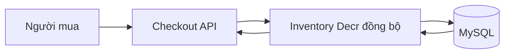
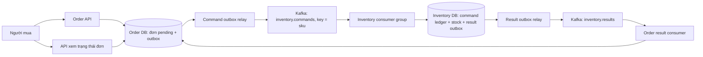

# ADR-001: Xử lý trừ kho bất đồng bộ bằng Kafka

| Thuộc tính | Giá trị |
| --- | --- |
| Ngày | 09/11/2026 |
| Trạng thái | Đề xuất — bài tập thiết kế, chưa triển khai |
| Phạm vi | Trừ kho trong hệ thống thương mại điện tử vào giờ cao điểm |
| Mục tiêu chính | Performance và Scalability, đồng thời giữ tính đúng đắn của tồn kho |
| Quyết định | Kafka làm bộ đệm; consumer xử lý theo SKU; MySQL là nguồn dữ liệu chuẩn |

## 1. Bối cảnh và vấn đề

Theo đề bài, hệ thống hiện tại bị sập vào giờ cao điểm khi chức năng `Inventory Decr` gọi trực tiếp MySQL và gây lock table. Luồng hiện tại có thể khái quát:



Khi nhiều người cùng mua sản phẩm bán chạy, các request cạnh tranh cập nhật cùng dữ liệu tồn kho. Thời gian chờ khóa làm transaction và connection tồn tại lâu hơn; connection pool cạn, request timeout và retry tiếp tục làm tăng tải. Luồng nhận đơn phụ thuộc trực tiếp vào tốc độ xử lý tồn kho nên bị ảnh hưởng dây chuyền.

**Phân biệt giả định với kết luận:** đề nêu lock table nhưng không cung cấp schema, storage engine, execution plan hoặc lock metrics. Với InnoDB, cập nhật theo khóa phù hợp thường dùng row lock; chưa thể kết luận mọi thao tác `UPDATE` đều khóa cả bảng. Thiết kế này xử lý tải đột biến và cạnh tranh ghi; đồng thời yêu cầu truy vấn theo SKU có index và transaction ngắn. Kafka không tự sửa truy vấn chậm hoặc khóa sai phạm vi.

## 2. Yêu cầu và giả định

### Yêu cầu chức năng cần giữ

- Trừ đúng số lượng khi còn đủ hàng; không để tồn kho âm.
- Một lệnh nghiệp vụ chỉ trừ kho một lần dù request hoặc message được gửi lại.
- Kết quả cuối cùng phân biệt thành công và không đủ hàng; không báo đơn đã được xác nhận khi mới nhận yêu cầu.
- Có thể truy vết từ đơn hàng đến lệnh trừ kho và kết quả.

### Mục tiêu phi chức năng đề xuất

Các con số dưới đây là **mục tiêu thiết kế để thẩm định**, chưa phải số đo hay cam kết đã đạt:

| Thuộc tính | Mục tiêu và cách hiểu |
| --- | --- |
| Độ trễ tiếp nhận | p95 của API nhận yêu cầu ≤ 200 ms trong tải được chấp nhận; đo riêng với thời gian trừ kho |
| Độ trễ nghiệp vụ | Từ lúc lưu yêu cầu đến kết quả tồn kho: p95 ≤ 3 giây, p99 ≤ 10 giây trong tải được chấp nhận |
| Khả năng mở rộng | Tăng partition/consumer để tăng xử lý các SKU khác nhau, trong giới hạn MySQL |
| Tính đúng đắn | Tồn kho không âm; không trừ lặp cùng `commandId`; lệnh đã nhận được lưu bền vững để xử lý lại |
| Khả năng quan sát | Theo dõi độ tuổi yêu cầu chờ, consumer lag, outbox backlog, DB lock wait, lỗi và số lệnh trùng |

### Giả định ảnh hưởng quyết định

- Doanh nghiệp chấp nhận trả trạng thái `PENDING_INVENTORY` trước khi có kết quả cuối cùng. Nếu bắt buộc xác nhận giữ hàng ngay trong cùng request thì cần quyết định kiến trúc khác.
- Mỗi lệnh trừ kho tác động một SKU, với `quantity` là số nguyên dương. `sku` có unique index/primary key trong bảng tồn kho InnoDB.
- MySQL Inventory DB là nguồn dữ liệu chuẩn; các đường trừ kho khác cũng phải giữ cùng điều kiện và cơ chế chống lặp.
- Order DB chịu được ghi tiếp nhận đơn và outbox. Việc tách luồng không được hiểu là loại bỏ mọi truy cập database khỏi API; tải này cần được cấp tài nguyên và đo riêng với Inventory DB.
- Bài không cung cấp tải thực tế, ngân sách hay năng lực vận hành Kafka; cần xác minh các giả định trước khi đưa vào sản xuất.

## 3. Các phương án đã cân nhắc

| Phương án | Lợi ích | Hạn chế / đánh đổi | Đánh giá |
| --- | --- | --- | --- |
| Giữ đồng bộ, tối ưu MySQL | Ít thành phần; kết quả tức thời; atomic conditional update giảm rủi ro đọc rồi ghi | API vẫn chờ Inventory DB; cùng một SKU vẫn là điểm nóng; khó hấp thụ đợt tăng tải dài | Cần tối ưu truy vấn trong mọi phương án, nhưng chưa đáp ứng mục tiêu tách tải |
| Kafka + consumer + MySQL | Có bộ đệm bền vững; kiểm soát tốc độ ghi; retry/replay; mở rộng theo partition | Kết quả đến sau; thêm broker, outbox, idempotency và vận hành backlog | **Chọn**, với điều kiện chấp nhận trạng thái chờ |
| Redis atomic Lua, đồng bộ MySQL sau | Trừ trên Redis nhanh; script kiểm tra/trừ nguyên tử trong phạm vi dữ liệu phù hợp | Phải giải quyết độ bền khi failover, idempotency và đối soát hai nguồn dữ liệu; đồng bộ ngược phức tạp | Chưa chọn vì không muốn đưa quyết định tồn kho sang một nguồn dữ liệu mới |
| Redis distributed lock trước MySQL | Có thể giảm một số cạnh tranh trong nhóm client hợp tác | Thêm round trip; lock lease có thể hết khi xử lý còn chạy; vẫn phải xử lý an toàn tại MySQL, có thể cần fencing token | Chưa chọn; không tự tăng năng lực ghi cho SKU nóng |
| In-memory lock/stock trong từng instance | Đơn giản và nhanh trong một process | Không phối hợp giữa nhiều instance; restart mất trạng thái | Không phù hợp hệ thống nhiều instance |

Redis atomic script và distributed lock là hai cơ chế khác nhau. Lua có thể gộp kiểm tra và trừ thành một thao tác nguyên tử; lock riêng không thay thế được điều kiện tồn kho tại nơi lưu dữ liệu chuẩn.

## 4. Quyết định kiến trúc

**Chọn xử lý bất đồng bộ qua Kafka, sử dụng transactional outbox ở phía phát sự kiện và transaction MySQL có chống lặp ở phía trừ kho.** API lưu yêu cầu rồi trả trạng thái chờ; chỉ xác nhận đơn sau khi nhận kết quả tồn kho thành công.



Sơ đồ mô tả các trách nhiệm logic. Các phần tử `DB` bao gồm bảng nghiệp vụ và outbox được ghi **trong cùng transaction cục bộ**; không giả định có distributed transaction giữa MySQL và Kafka.

### 4.1. Tiếp nhận yêu cầu

1. API kiểm tra request và idempotency key. Key gắn với danh tính người gọi và nội dung yêu cầu; dùng lại key với payload khác bị từ chối.
2. Trong **một transaction Order DB**, tạo đơn `PENDING_INVENTORY` và bản ghi outbox chứa `commandId`, `orderId`, `sku`, `quantity`, `schemaVersion`, `createdAt`.
3. Sau khi transaction commit, trả `202 Accepted` kèm `orderId`, trạng thái chờ và địa chỉ truy vấn trạng thái. Nếu commit thất bại thì không trả thành công; nếu client không biết kết quả do timeout, retry cùng key để tra lại yêu cầu cũ.
4. Relay đọc outbox, gửi Kafka với key là `sku`, đợi broker xác nhận rồi đánh dấu đã phát. Relay crash sau publish có thể gây gửi lại; consumer phải xử lý trùng.

Không ghi đơn rồi gọi Kafka như hai bước độc lập không có outbox: nếu một bước thành công và bước kia thất bại, đơn có thể bị bỏ quên hoặc xuất hiện lệnh không có đơn tương ứng.

### 4.2. Partition và mức song song

- Cùng SKU dùng cùng partition để consumer xử lý tuần tự luồng lệnh của SKU đó. Thứ tự này là thứ tự Kafka ghi nhận, không cam kết thứ tự nhấp mua tuyệt đối giữa nhiều producer.
- Một consumer group chia partition cho nhiều consumer. Số consumer hoạt động hữu ích không vượt số partition; không song song hóa tùy tiện các message cùng SKU trong worker.
- Tăng partition giúp phân tán nhiều SKU, **không** làm một SKU nóng được xử lý song song an toàn hơn. Một partition cũng chứa nhiều SKU, nên SKU quá nóng có thể làm các SKU cùng partition chậm theo.
- Không tăng partition tùy tiện trong đợt bán: phép ánh xạ key có thể đổi. Khi đổi partition count, cần drain/cutover có kiểm soát để không xử lý đồng thời lệnh cũ và mới của cùng SKU.
- Giới hạn số transaction đang chạy theo ngân sách connection và khả năng MySQL. Tăng consumer vô hạn có thể làm tái xuất hiện nghẽn database.

### 4.3. Trừ kho và chống xử lý lặp

Consumer thực hiện các bước sau trong **một transaction Inventory DB**:

1. Chèn command ledger với `commandId` có unique constraint; ghi cả nội dung hoặc payload hash để phát hiện key bị dùng sai.
2. Nếu `commandId` đã tồn tại và payload khớp, dùng lại kết quả đã lưu, không trừ tiếp. Kết quả cũ đã có result outbox được commit cùng ledger; không cần tạo tác động nghiệp vụ mới.
3. Với lệnh mới hợp lệ, cập nhật tồn kho có điều kiện:

```sql
UPDATE inventory
SET available_qty = available_qty - :quantity
WHERE sku = :sku
  AND available_qty >= :quantity;
```

`:quantity` phải là số nguyên dương đã kiểm tra; các giá trị là parameter binding, không nối chuỗi SQL. Cập nhật một dòng nghĩa là trừ thành công; không cập nhật dòng nào nghĩa là SKU không tồn tại hoặc không đủ hàng, cần ghi kết quả từ chối tương ứng nếu nghiệp vụ cần phân biệt. Không dùng cách đọc số tồn ra ứng dụng rồi ghi số mới mà thiếu bảo vệ đồng thời.

4. Ghi kết quả cuối cùng `DECREMENTED` hoặc `REJECTED` vào ledger, đồng thời thêm sự kiện kết quả vào result outbox.
5. Commit transaction, sau đó mới commit Kafka offset. Khi transaction thất bại, rollback cả ledger, tồn kho và outbox.

Thiết kế dùng **at-least-once delivery kết hợp hiệu ứng nghiệp vụ idempotent**, không tuyên bố exactly-once xuyên Kafka–MySQL. Kafka transaction riêng không bao trùm transaction MySQL. Unique constraint chống hai lần xử lý cùng command; conditional update bảo vệ tồn kho trước các command khác nhau. MySQL vẫn có row lock, nhưng transaction ngắn và mức song song được kiểm soát giúp giảm tranh chấp so với request tràn trực tiếp.

### 4.4. Trả kết quả nghiệp vụ

- Result relay phát sự kiện từ outbox; Order result consumer cũng chống lặp theo event/command ID và cập nhật đơn trong cùng transaction với dấu đã xử lý.
- Chỉ chuyển `PENDING_INVENTORY` sang `INVENTORY_CONFIRMED` khi nhận kết quả `DECREMENTED`; chuyển sang `REJECTED_OUT_OF_STOCK` khi bị từ chối vì thiếu hàng. Lỗi kỹ thuật hoặc message chưa xử lý không được coi là hết hàng.
- Client xem trạng thái hoặc nhận thông báo cập nhật. `202 Accepted` chỉ nói yêu cầu đã được tiếp nhận bền vững, không phải đã mua thành công hay đã giữ được hàng.
- Trạng thái tồn kho hiển thị ở catalog có thể cũ; quyết định chấp nhận mua dựa trên Inventory DB tại lúc consumer xử lý.

## 5. Xử lý lỗi và giới hạn tải

| Tình huống | Cách xử lý |
| --- | --- |
| Relay dừng hoặc Kafka tạm lỗi | Outbox giữ lệnh chưa phát; retry có backoff; cảnh báo độ tuổi outbox. Đạt giới hạn tiếp nhận thì từ chối yêu cầu mới thay vì tích vô hạn |
| Consumer chết trước DB commit | Transaction rollback; message được giao lại; chưa có tác động tồn kho hoàn tất |
| Consumer chết sau DB commit nhưng trước offset commit | Kafka giao lại; command ledger trả kết quả cũ, không trừ thêm |
| Deadlock hoặc timeout MySQL | Rollback; retry có giới hạn và backoff. Nếu muốn giữ thứ tự theo partition thì pause/retry tại partition; retry topic có thể làm đổi thứ tự |
| Payload hỏng hoặc retry vượt ngưỡng | Ghi nhận lỗi và chuyển DLQ qua đường phát bền vững trước khi bỏ qua offset; cảnh báo và có quy trình replay bằng cùng `commandId`. Đơn vẫn chờ/được đánh dấu cần xử lý, không báo xác nhận |
| Hết hàng | Kết quả nghiệp vụ kết thúc `REJECTED`, không retry như lỗi hạ tầng |
| Kết quả chưa về nhưng client timeout | Tra trạng thái bằng `orderId`; không tự tạo command mới và không tự coi là thất bại |
| Đơn bị hủy sau khi đã trừ kho | Phát command hoàn kho riêng có ID duy nhất, liên kết command gốc; chống hoàn lặp và quản lý chuyển trạng thái. Timeout đơn thuần không đủ để tự hoàn |

Kafka chỉ hấp thụ burst hữu hạn. Nếu tốc độ đến `λ` lớn hơn tốc độ xử lý `μ` kéo dài, backlog tăng xấp xỉ `(λ − μ) × thời gian`. Muốn có độ trễ ổn định thì cần năng lực xử lý dài hạn vượt tốc độ nhận trung bình và có phần dự phòng để tiêu backlog.

Áp dụng admission control theo năng lực đã đo: giới hạn request theo người dùng/campaign, theo dõi outbox lẫn Kafka, và trả `429` hoặc `503` kèm thời gian thử lại khi vượt ngưỡng. Ngưỡng độ tuổi yêu cầu chờ 10 giây là điểm khởi đầu để đánh giá giảm tiếp nhận vì sát mục tiêu p99; phải hiệu chỉnh theo kết quả đo, dung lượng và mục tiêu kinh doanh. Không chuyển sang ghi trực tiếp Inventory DB khi Kafka lỗi vì sẽ phá cơ chế điều tiết và tạo hai đường xử lý cạnh tranh.

## 6. Hệ quả và các đánh đổi chấp nhận

| Quyết định | Lợi ích kỳ vọng | Chi phí / rủi ro chấp nhận |
| --- | --- | --- |
| Tiếp nhận trước, trừ kho sau | API không chờ khóa Inventory DB; trải tải đột biến theo thời gian | Người mua phải chờ kết quả; có thể nhận từ chối sau `202`; cần giao diện và trạng thái đơn phù hợp |
| Kafka làm bộ đệm | Có replay, theo dõi lag và phân tải theo partition | Tốn hạ tầng, lưu trữ, vận hành broker và quản lý schema/retention |
| MySQL tiếp tục là nguồn chuẩn | Giữ conditional update và transaction rõ ràng; không phải đối soát hai bộ đếm chuẩn | Không xóa giới hạn ghi MySQL, vẫn có lock; một SKU nóng vẫn có throughput hữu hạn |
| Outbox + ledger | Khôi phục được khi crash, tránh mất lệnh do dual write và tránh trừ lặp | Thêm bảng, relay, unique index, ghi dữ liệu và dọn lịch sử |
| Xử lý theo partition | Giảm tranh chấp và hỗ trợ thứ tự theo key | SKU nóng gây chậm các SKU cùng partition; retry giữ thứ tự làm tăng thời gian chờ |
| Admission control | Bảo vệ hệ thống và giữ backlog trong giới hạn | Một phần người dùng bị từ chối/đề nghị thử lại trong giờ cao điểm |

**Đánh đổi được chọn cho đề xuất:** ưu tiên ổn định luồng nhận đơn và bảo toàn tồn kho hơn việc xác nhận tồn kho ngay trong cùng HTTP request; chấp nhận độ trễ kết quả và độ phức tạp vận hành cao hơn. Tồn kho chuẩn vẫn được bảo vệ bằng transaction MySQL; tính nhất quán cuối cùng nằm ở việc lan truyền kết quả sang trạng thái đơn và các bản đọc.

Không xem việc API trả nhanh hơn là bằng chứng toàn hệ thống xử lý nhanh hơn. Tổng số lần ghi có thể tăng do outbox và ledger; lợi ích chính là điều tiết tải, tách vòng đời request và kiểm soát mức song song. Hiệu quả thực tế phải được đo cả ở thời gian hoàn tất đơn.

## 7. Kế hoạch áp dụng và tiêu chí thẩm định

Đây là kế hoạch đề xuất, **chưa thực hiện**:

1. Đo baseline: latency nhận đơn và hoàn tất đơn, throughput, DB lock wait, connection pool, deadlock; xác minh table lock/row lock, index SKU và phạm vi transaction.
2. Chuẩn hóa conditional update; thêm command ledger, outbox và trạng thái chờ. Giữ transaction ngắn, không gọi mạng trong transaction trừ kho.
3. Triển khai relay/consumer, dashboard, cảnh báo và quy trình DLQ/replay; chính sách lưu ledger phải bao phủ cửa sổ retry/replay và không xóa dấu chống lặp trong khi message cũ còn có thể quay lại.
4. Đánh giá trên môi trường thử nghiệm: tải bình thường, burst SKU nóng, command trùng, consumer crash ở hai phía DB commit, Kafka lỗi, DB lỗi và backlog hồi phục. Xác minh không âm tồn kho, không trừ lặp và đơn cuối cùng khớp kết quả ledger.
5. Mở dần theo tập SKU/campaign. Mỗi SKU tại một thời điểm chỉ có một đường ghi được chọn; khi cutover phải chặn nhận mới cho tập đó và drain lệnh đang chờ, không trừ bằng cả đường cũ lẫn mới.
6. Chỉ mở rộng khi đạt mục tiêu tiếp nhận **và** hoàn tất nghiệp vụ, không có sai lệch tồn kho, backlog tiêu hết trong ngân sách đã thống nhất. Nếu rollback, dừng nhận mới và xử lý/đối soát các lệnh pending trước khi chuyển quyền ghi về đường cũ.

Với đơn nhiều SKU, cần bổ sung quy trình giữ hàng/compensation theo từng dòng và chỉ xác nhận khi toàn bộ dòng thành công. Một partition theo SKU không tạo transaction nguyên tử cho cả đơn; ADR này không cam kết tính nguyên tử đa SKU.

## 8. Điều kiện xem xét lại quyết định

- Doanh nghiệp không chấp nhận xác nhận bất đồng bộ hoặc tỷ lệ khách hủy khi chờ quá cao.
- Một SKU nóng vượt năng lực của một luồng cập nhật MySQL dù đã tối ưu và điều tiết; khi đó cân nhắc phân bổ quota tồn kho hoặc cơ chế reservation khác với ADR riêng.
- Tải thực tế nhỏ, tối ưu MySQL đồng bộ đã đáp ứng mục tiêu với chi phí thấp hơn.
- Nhóm chưa đủ năng lực vận hành Kafka/outbox hoặc chi phí vượt ngân sách.

Tài liệu này là đề xuất kiến trúc dựa trên dữ kiện trong đề và các giả định đã nêu. Chưa chạy benchmark, load test, triển khai hạ tầng hoặc render sơ đồ Mermaid; các mục tiêu và lợi ích kỳ vọng chưa được xác minh thực nghiệm.
